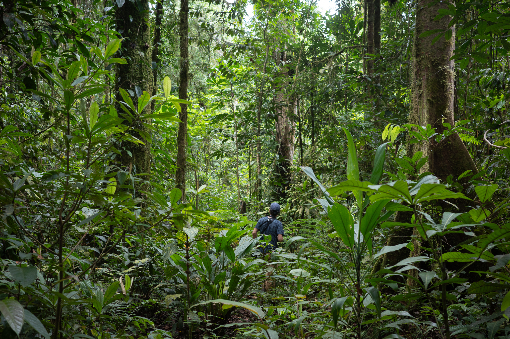

The Linck Lab studies vertebrate conservation genomics, speciation, and biogeography in the [Department of Ecology](https://www.montana.edu/ecology/) at [Montana State University](https://www.montana.edu/) in Bozeman.
{: .display-4 .welcomefont}

{:style="max-width: 100%; height: auto;"}
{: .text-center}